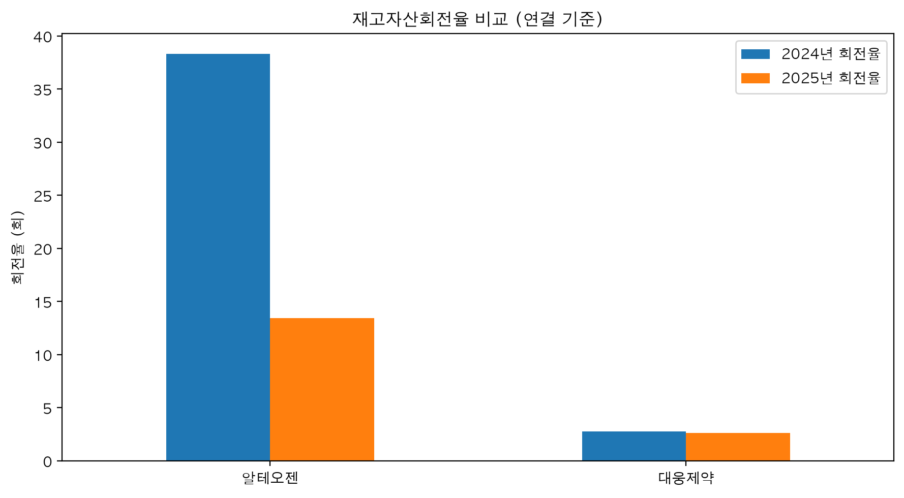

# BioAuditAnalyzer 2.0

**OpenDART 기반 제약·바이오기업 재무분석 프로젝트**

## 1. 프로젝트 소개

공인회계사의 관점에서 재무데이터 분석과 감사위험 식별을 연결하기 위한 Python 프로젝트입니다.

금융감독원 OpenDART API로 기업의 공시 재무정보를 수집하고, 주요 재무지표를 계산하여 기업별 재무구조와 계정 변동을 분석합니다.

**분석 대상:** 알테오젠, 대웅제약  
**분석 기간:** 2024~2025년 실적, 재고자산회전율 계산에 2023년 기말 잔액도 활용  
**재무제표 기준:** 연결재무제표(CFS)

## 2. 프로젝트 목표

- 반복적인 재무데이터 수집과 재무비율 계산의 자동화
- 기업별 매출·수익성·재고자산 변동 비교
- 재무정보의 변화와 관련 회계적 검토사항 연결
- 데이터 분석 결과의 재현성과 검증 가능성 확보

## 3. 구현 기능

- OpenDART API 기업고유번호 조회
- 2024~2025년 연결재무제표 수집
- 표준계정 ID를 이용한 주요 재무항목 추출
- 매출액 증가율 및 영업이익률 계산
- 재고자산 증가율·재고자산회전율 계산
- 기업별 재무지표 시각화
- CSV 및 PNG 분석 결과 저장
- 서로 다른 연도 사업보고서의 비교금액 검증

## 4. 분석 결과

두 기업의 사업모델과 재무구조를 고려해 매출, 영업이익률, 재고자산 등을 비교했습니다.

재고자산회전율의 하락이나 재고자산 증가율의 확대는 추가 분석이 필요한 신호일 수 있지만, 그 자체로 회계오류 또는 부정을 의미하지는 않습니다.

## 5. 프로젝트 실행방법

1. Python 3.10 이상의 환경을 준비합니다.
2. 저장소를 내려받고 프로젝트 폴더로 이동합니다.
3. `pip install -r requirements.txt`로 라이브러리를 설치합니다.
4. `jupyter lab`을 실행합니다.
5. `notebooks/01_financial_analysis.ipynb`를 열어 셀을 순서대로 실행합니다.
6. 실행 과정에서 발급받은 OpenDART API 인증키를 입력합니다.

API 키는 저장소에 포함하지 않습니다.

## 6. 데이터 출처

- 금융감독원 OpenDART API: https://opendart.fss.or.kr/
- 분석 대상 기업의 2025년 사업보고서
- 재무제표 기준: 연결재무제표
- 상세 출처: `outputs/source_manifest.csv`

## 7. 분석의 한계

본 프로젝트는 공개 공시자료만을 활용합니다.

공개 재무정보의 변동은 추가 검토가 필요한 항목을 식별하는 데 활용할 수 있으나, 실제 감사의 충분하고 적합한 증거를 대체하지 않습니다.

따라서 본 프로젝트의 분석 결과는 회계오류나 부정의 존재에 대한 판단 또는 감사의견이 아닙니다.

## 8. 향후 개발

- 계정 변동을 이용한 추가 검토 신호 탐지
- 검토 신호와 관련 K-IFRS 및 PBC 자료의 연결
- 감사절차 추천 기능
- 분석 결과 자동 보고서 생성
- 예외처리 및 단위 테스트 강화

## 9. 개발 및 AI 활용

AI를 코드 작성과 오류 해결, 분석 아이디어 검토의 보조수단으로 활용하고 있습니다.

프로젝트의 회계적 분석 논리, 계정별 판단 및 공시 원문 검증을 중심으로 결과의 적정성을 검토합니다.

개인 학습 및 포트폴리오 목적의 프로젝트이며, 실제 회계감사를 수행하는 시스템이 아닙니다.

## 분석방법

탐지 규칙과 검증방법은 [분석방법 문서](docs/methodology.md)를 참고하세요.